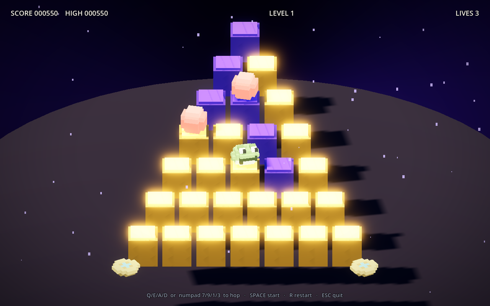
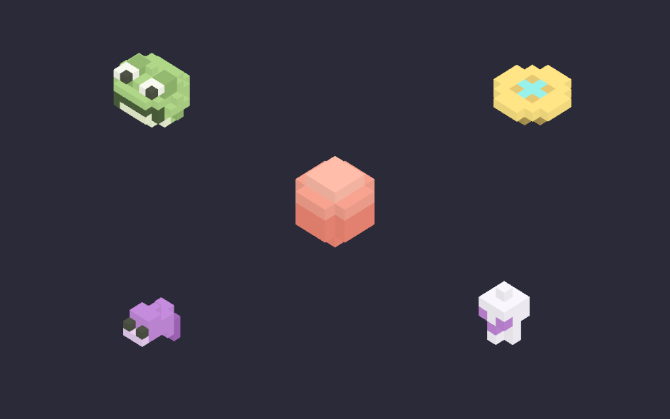

# Bullfrog Blox

A voxel arcade hopper written from scratch in Godot 4, in the tradition of the
1982 classic *Q*bert*: a very large bullfrog paints a 28-cube pyramid by hopping
across it, while red balls, a green nuisance and a snake that hunts it down try
to knock it off. Two spinning discs carry it back to the top.

Every model is a voxel grid built in code, every sound is a square wave
generated at startup, and there is not a single imported model, texture or audio
file in the repository — it is source only.



The cast, left to right: the bullfrog, a red ball, Coily's egg, the snake, and an
escape disc (all built from code, all in `scripts/voxel_models.gd`):



## Play

Requires [Godot 4.7](https://godotengine.org/download) (a plain install is
enough; no .NET build, no plugins).

```bash
git clone https://github.com/mg4466/bullfrog-blox.git
cd bullfrog-blox
godot --headless --import     # once: builds Godot's script class cache
godot --path .
```

Or just `make run`, which does both.

On Arch, `sudo pacman -S godot` works; otherwise drop the official Linux
binary somewhere on your `PATH`. You can also open `project.godot` in the
editor and press F5 — the editor does the import for you.

That `--import` step is a Godot requirement, not this project's: scripts that
use `class_name` are resolved through a cache the editor normally writes. A
fresh clone has no cache, so a plain `godot --path .` fails to compile until it
has been imported once.

## Controls

| Key | Action |
| --- | --- |
| `Q` / numpad `7` | hop up-left |
| `E` / numpad `9` | hop up-right |
| `A` / numpad `1` | hop down-left |
| `D` / numpad `3` | hop down-right |
| `Space` | start |
| `R` | restart after game over |
| `Esc` | quit |

Mashing a direction during a hop queues one extra hop, the way the arcade
joystick did.

## Rules

Hop on every cube to paint it the target colour before the enemies get you.

* **Tiles.** Level 1 needs one hop per cube. Level 2 needs two (blue → green →
  gold). From level 3 the three states *cycle*, so a third hop resets the cube —
  you have to plan the order you walk in.
* **Red balls** hop downhill at random. They kill you on contact, but you can
  squash one by landing on it.
* **Slick** (green, from level 2) does the same, and flips the cube it lands on
  one state backwards.
* **Coily** (from level 3) drops in as an egg, hatches at the bottom of the
  pyramid, then hops along the shortest route to you. The only way to kill it
  is to jump onto a disc: it follows you off the edge and falls.
* **Discs** sit just off the two bottom corners. Landing on one flies you to the
  apex; each disc is single-use per round.
* Falling off the edge costs a life. Three lives.

| Event | Points |
| --- | --- |
| Hop onto a cube | 25 |
| Squash a ball or Slick | 100 |
| Ride a disc | 500 |
| Kill Coily with a disc | 500 |
| Clear a round | 1000 + 250 per level |

The high score is saved to the Godot user directory (`user://bullfrog_blox.cfg`).

## Tests

Two headless suites, both part of the repository:

```bash
# Everything, in order (this imports first):
make test

# 318 checks over the pure rules: pyramid shape, projections, state rules,
# hop arcs, chase AI, voxel mesh geometry and winding.
godot --headless --path . --script res://tests/test_logic.gd

# Every hop key and the start key, sent as real input events.
godot --headless --path . res://tests/controls.tscn

# Boots the real game, plays it with an autopilot until a round is cleared,
# then dies on purpose until game over and checks that restarting is clean.
godot --headless --path . res://tests/playthrough.tscn --fixed-fps 60 --quit-after 8000
```

`tests/capture.tscn` regenerates the screenshots in `docs/`, and
`tests/measure.tscn` prints the screen geometry (cube size, row spacing, board
bounds) so layout regressions can be checked numerically.

## How it is built

| File | Responsibility |
| --- | --- |
| `scripts/board.gd` | Pure rules: which cubes exist, the four move vectors, world projection, tile-state transitions, Coily's greedy chase |
| `scripts/hop.gd` | Jump maths (linear travel plus a parabolic bump) |
| `scripts/voxel_builder.gd` | Sparse voxel dictionary → `ArrayMesh` with culled faces and vertex colours |
| `scripts/voxel_models.gd` | The cast: player, red ball, Slick, Coily's egg and snake, disc |
| `scripts/game.gd` | The conductor: phases, scoring, enemy scheduling, level flow |
| `scripts/tile.gd`, `player.gd`, `enemy.gd` | Presentation for each thing on the board |
| `scripts/hud.gd`, `synth.gd` | Overlay and procedural sound |

### The look

The scene is lit rather than painted: a warm key light rakes across the board and
drops real shadows onto a ground plate, a cool rim separates the silhouettes, and
finished cubes glow past the bloom threshold. The background is a shader gradient
with a soft pool of light behind the pyramid, plus a vignette.

The characters are deliberately *unshaded*: their lighting is baked into their
vertex colours (top faces brightest, undersides darkest), so the palette stays
exactly as authored instead of turning beige under a physically-correct key
light. They still cast shadows into the world, which is what grounds them.

The full walkthrough — coordinate system, why the stage is rotated 45°, why the
voxel quads are wound the way they are, and how the tests caught the layout bugs —
is in [docs/LEARNING.md](docs/LEARNING.md).

## Not implemented

* No attract mode or demo playback, no music, no gamepad remapping.
* One board shape only: every level is the 7-row pyramid (levels differ in
  tile rules and enemies, not in geometry).
* No Coily variants (the arcade's second snake), no level intermissions.
* When the board empties, a replacement red ball arrives on a timer rather than
  the arcade's scripted waves.

## License

MIT — see [LICENSE](LICENSE).
